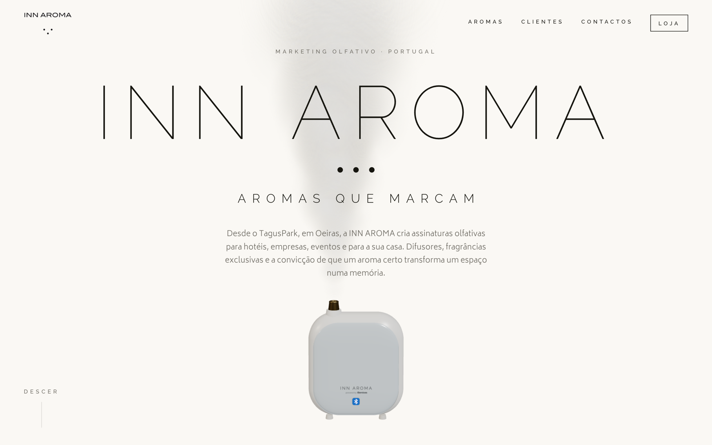
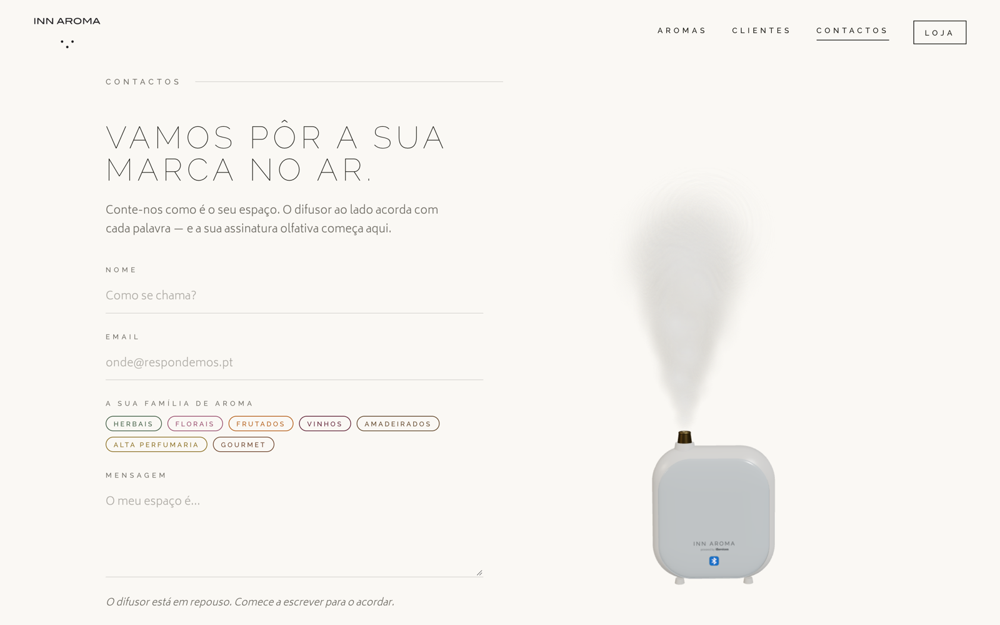

# INN AROMA — proposta de site (conceito)

> **⚠️ Proposta não oficial.** Este site é um conceito de redesign que criei por iniciativa própria para a INN AROMA, empresa portuguesa de marketing olfativo. **Não é o site oficial** ([innaroma.pt](https://innaroma.pt)) e **não foi aprovado nem encomendado pela empresa**. A marca, os produtos e os logótipos de clientes pertencem aos respetivos donos e aparecem aqui apenas para demonstrar a proposta.

**[▶ Ver a proposta ao vivo](https://inn-aroma.vercel.app)**



## A ideia

Uma marca de aromas vende uma coisa que não se vê. O desafio do site era fazer **sentir** o produto através do ecrã: o difusor aparece em 3D, a névoa sobe devagar e a página respira com calma, como um espaço perfumado.

A proposta foi pensada para dois públicos ao mesmo tempo:

- **Empresas** (hotéis, aeroportos, retalho, clínicas, eventos) que procuram credibilidade e um contacto rápido.
- **Consumidores** que querem escolher um difusor ou um aroma para casa e seguir para a loja.

## Destaques

- **Difusor em 3D** feito com three.js, com partículas de névoa animadas no hero.
- **Contactos que reagem:** o difusor está "em repouso" e acorda à medida que a pessoa escreve a mensagem.
- **Sete famílias de aromas** (herbais, florais, frutados, vinhos, amadeirados, alta perfumaria, gourmet), cada uma com a sua cor.
- **Imagens de produto em ambiente geradas com IA** (Gemini), a partir de prompts escritos para cada cenário (`scripts/gen-images.mjs`).
- **Performance:** imagens WebP, three.js carregado à parte (code-splitting) e hero otimizado.
- **Mobile:** menu hambúrguer e cabeçalho que ganha fundo ao fazer scroll.



## Stack

React 19 · Vite · three.js · React Three Fiber + Drei · Motion · publicado na Vercel.

O posicionamento, os públicos e o sistema visual estão documentados em [`PRODUCT.md`](PRODUCT.md) e [`DESIGN.md`](DESIGN.md).

## Correr localmente

```bash
npm install
npm run dev
```

---

### In English

**Unofficial concept.** A self-initiated redesign proposal for INN AROMA, a Portuguese scent-marketing company. It is not the official site and was not commissioned or approved by the company; all brands and client logos belong to their owners. Highlights: a three.js diffuser with animated mist, a contact form that "wakes up" the diffuser as you type, seven colour-coded scent families and AI-generated lifestyle product shots (Gemini). Built with React, Vite, React Three Fiber and Motion. **[See the live concept](https://inn-aroma.vercel.app)**.
